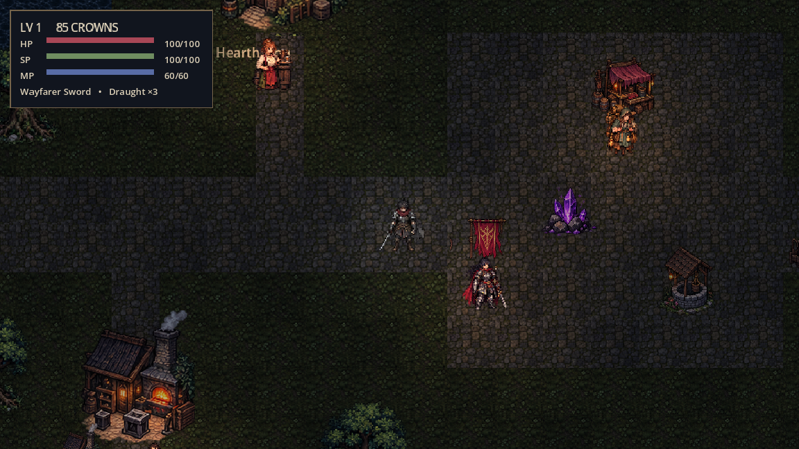
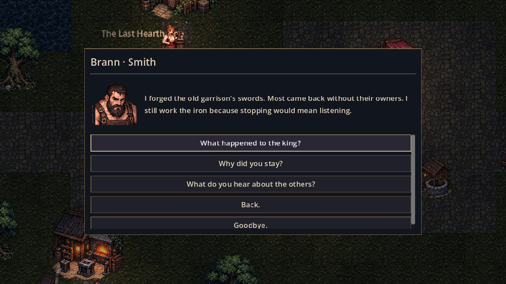

# ASHEN VEIL — Chapter I

**[Start here: easy download and play instructions](START_HERE.md)** · **[Download the macOS app](https://github.com/tigbittyboy-jpg/ASHENVEIL/raw/refs/heads/main/downloads/AshenVeil-macOS.zip)**

An original, offline Godot 4 dark fantasy action RPG first playable. Explore Hollowmere, recover the crypt sigil in the Weeping Forest, defeat the Bellkeeper, and learn what waits inside the Veil Shrine.

This is an early playable slice, not the finished 30–60 minute polished release described in the master brief. The core progression and save loop are implemented; encounter variety, narrative depth and balancing need further work. See [CHANGELOG.md](CHANGELOG.md) for the 0.3.0 playtest fixes. No timed human playthrough or Apple Silicon performance measurement has been completed.



## Open and play

1. Install **Godot 4.6.3 Standard** from https://godotengine.org/download/macos/ (GDScript version; .NET is unnecessary).
2. Import `project.godot` from this repository in Godot's project manager.
3. Press **F6** with `scenes/main.tscn` open, or **F5** to run the project.
4. Select **New Adventure**. Speak to Captain Ilya in the central square by the banner and accept **The Silent Bell**.

The downloadable `downloads/AshenVeil-macOS.zip` (also generated locally under `builds/`) contains a standalone `.app` with native ARM64 and x86_64 slices. Extract it in Finder and launch the application. It needs no Godot installation, terminal process, internet connection or external dialogue service. This is an ad hoc signed, unnotarized development bundle; the revised 0.3.0 launch on macOS has **not** been confirmed. Gatekeeper may block it; see [the damaged-app recovery steps](START_HERE.md#if-macos-says-the-app-is-damaged). Review the source and use your own local Godot export if you prefer. For local development signing on a Mac, `codesign --force --deep --sign - /path/to/Ashen\ Veil.app` applies an ad hoc signature, not notarization. Do not disable macOS security system-wide.

## Controls

| Action | Keyboard / mouse | Gamepad |
|---|---|---|
| Move | WASD | Left stick |
| Attack toward cursor | Left mouse | X (movement facing) |
| Block | Right mouse | Left shoulder |
| Dodge | Space | A |
| Sprint | Shift | — |
| Ember projectile | F | — |
| Use Healing Draught | Q | Right shoulder |
| Interact | E | Y |
| Inventory / equipment | I | — |
| Journal | J | — |
| Attributes / skills | C | — |
| Pause / close menu | Esc | Start |

Menus support mouse, keyboard arrows, Enter and normal Godot UI navigation. The runtime InputMap is defined in `scripts/game.gd::inputs`; edit its bindings to customize controls. There is no in-game rebinding screen yet. Keyboard and mouse are the complete supported control scheme; gamepad is partial and physical hardware testing remains outstanding.

## First chapter walkthrough

- The villagers occupy a road-linked square, inn, forge, chapel, cottage and ruined watchtower. Mara sells five weapon categories, armor and consumables. Brann upgrades your equipped weapon using Grave Iron and Crowns. Sister Elowen heals and wants three Weeping Herbs. Tovin wants his brother's Silver Charm. Nell offers paid rest.
- Speak to Ilya for the main quest and the three-elite side quest. Quest delivery accepts an unaccepted delivery quest automatically; late main/elite acceptance also pays for already-completed objectives.
- Use crystals to heal and autosave. The village crystal is on the central road. Forest and crypt crystals mark later checkpoints.
- Follow the road east and press E at the door. Fight patrols in the forest; gather three green herbs. A southwest chest holds the Silver Charm. Returning it or keeping it changes Tovin's dialogue.
- Defeat the armored sentinel near the eastern forest gate for the Crypt Sigil. The lost hound guards the southwest clearing. The crypt gate checks the sigil and will reject entry without it.
- In the crypt, follow the openings between stone partitions. Avoid spike traps; defeat the crypt knight for the third elite objective. The Bellkeeper occupies the eastern chamber. Watch its orange attack circles, dodge through attacks, and use recovery windows. Blocking costs stamina; dodge breaks stun/slow. Phase two summons enemies and adds radial projectiles; phase three shortens warnings to 0.85 seconds and recovery to 1.15 seconds. Boss strikes no longer stun.
- Defeating the boss gives the Bellkeeper Blade and permanently unlocks the eastern shrine. Equip the blade through Inventory. Enter the shrine and interact with its crystal for the chapter conclusion and main quest reward.
- Esc opens three manual save slots. **Save and Return to Title** writes an autosave. Continue can restore any of the four slots. Death offers checkpoint respawn, retaining discoveries at a cost of ten Crowns.

## Systems present

Four connected map layouts; eight named NPCs; six enemy archetypes; three elites; a three-phase boss; five quests; twelve equipment items; eight consumables/materials; sword, dagger, axe, staff and bow combat; stamina, blocking, dodge immunity, projectiles, damage and statuses; leveling to 20; five attributes; six skills; validated buying/selling and upgrades; equipment slots; inventory stacking; authored conversations and structured relationship memories; checkpoint/manual saves with schema validation and backup recovery; volume controls; original generated gothic sprites, tiles, portraits, props and synthesized audio.

Enemy deaths and opened containers persist, so defeated encounters do not respawn when you revisit maps. Restart a new adventure for a fresh world. The full item catalogue fits within the 24 distinct-item capacity.

## Conversations and menus

Press **E** near a villager to open their portrait and authored response choices. Use arrows / Enter, D-pad / A, or click a response. History and story topics branch into further choices. **Back** returns to the greeting; **Goodbye** closes the conversation. Escape backs out of a branch, returns from a service, or closes the greeting. Movement and combat are locked while menus are open.

All dialogue is predetermined and offline. Each of the eight villagers has distinct histories, rumors, dangers, Bellkeeper advice and reactions. Greetings respond to previous visits, saved relationships, quest completion, discoveries and boss/story progress. Jobs offer explicit acceptance and delivery choices; completed jobs stay completed. Mara's wares, Brann's forge, Elowen's healing and Nell's rooms open through their relevant responses, with a return to conversation.

The screen HUD uses compact resource bars and hides behind menus. The journal separates selectable active/completed quests from their objectives and rewards; inventory and shops use selectable items, descriptions and comparisons. Long lists scroll, headings stay outside the scrolling body, and controls/help live in the pause menu.



## Saves and settings

Godot stores `slot_0.json` (autosave), `slot_1.json` to `slot_3.json`, temporary writes and backups under `user://`. On macOS this normally resolves to `~/Library/Application Support/Godot/app_userdata/Ashen Veil/`. Existing version-one saves from 0.1.x and 0.2.0 remain compatible; relocated map structures move an unsafe saved position to nearby open ground. Settings are saved with each game slot and restored when loading it. New Adventure resets settings to defaults. A broken primary save falls back to its backup; unsupported save versions are rejected safely. Loading an older save discards its obsolete AI preference while preserving inventory, quests and NPC memories. Unsupported schema versions still require future migration. Tests use a separate data directory and do not modify normal saves.

## Development and validation

```sh
cd /workspace/ASHENVEIL
bash tools/cloud_setup.sh
```

On a normal local computer (with writable home directories):

```sh
godot --headless --path . --editor --quit
godot --headless --path . res://tests/runner.tscn
godot --path .
```

The test suite writes its test slots. Set `XDG_DATA_HOME` to an isolated temporary directory on Linux, as `cloud_setup.sh` does, to preserve your playthrough. See `TEST_RESULTS.md` for actual evidence and `docs/SMOKE_TEST.md` for human validation.

Art regeneration needs Python 3 and Pillow; both are available in the prepared cloud environment. Committed PNG/WAV assets need neither at runtime:

```sh
python tools/generate_assets.py
python tools/import_art.py
python tools/generate_dialogue.py
python tools/check_audio.py
```

`import_art.py` deterministically extracts the committed original source atlases; `generate_dialogue.py` rebuilds the authored trees. Review changes before committing. The legacy `generate_content.py` overwrites content defaults and should not be run over edited content. Sprite dimensions and replacement conventions are in `docs/ASSETS.md`.

## Export

Install the **matching 4.6.3 export templates** using Godot's template manager. The cloud setup already retains the verified official macOS template outside the checkout. Choose the `macOS Apple Silicon` preset, or run:

```sh
godot --headless --path . --export-release "macOS Apple Silicon" builds/AshenVeil-macOS.zip
```

The official template is universal and includes native ARM64. The project enables the required ETC2/ASTC texture import setting. Distribution signing/notarization must be performed on an appropriately configured Mac with your Apple credentials. No signing identity is embedded in this repository.

## Known limitations and next work

- Maps and content are compact; play duration and balance have not been validated by a complete unassisted playthrough.
- Player art has eight directions with idle, three walking poses, two sword attack poses, dodge and hurt. Enemies and NPCs use detailed single-frame sprites with procedural movement; full enemy/boss animation, weapon-specific attack sheets, player death animation, hitstop and screen shake remain future work.
- NPCs have authored branching trees and saved contextual reactions, but no daily routines or schedules. Shops have unlimited stock. Containers deliver immediate loot rather than physical ground drops.
- Enemy AI implements patrol/chase/attack/recover/retreat/stunned/dead, sight checks and simple territory control. Investigate/alert/ally coordination and sophisticated navigation are absent. Enemies can stall against obstacles. The hound is fast melee rather than a dedicated lunge state.
- Core health, stamina, mana, attack, armor, crits and movement work. Full elemental resistances, separate magic-attack equipment statistics and broader status interactions remain unfinished. Hex briefly stuns projectile targets; Ember increases projectile damage.
- The boss has phases, telegraphs, summons, radial waves and a victory screen, but lacks a cinematic intro, arena doors and bespoke animation/audio for every pattern.
- Save corruption validation and backups work. Settings persist per slot; standalone settings storage, save migration and asynchronous disk I/O remain future work.
- Gamepad hardware, native macOS launch, Retina behavior, real audio-device playback, Developer ID signing, notarization and Apple Silicon 60 FPS performance have not been verified.

Continue development by first performing the manual smoke procedure on macOS, fixing discovered blockers, then deepening encounters and dialogue. `ARCHITECTURE.md` identifies the ownership of each system.
